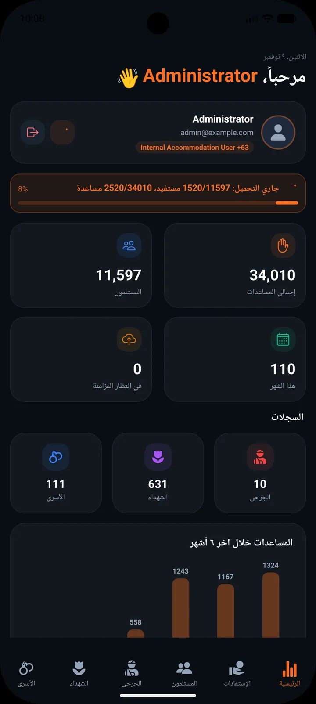
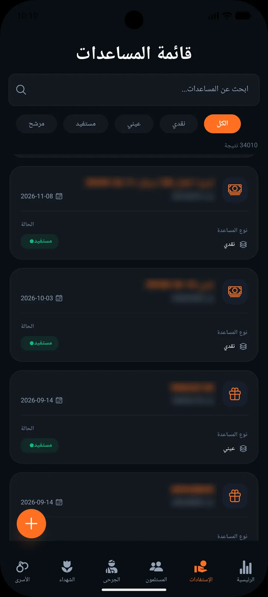
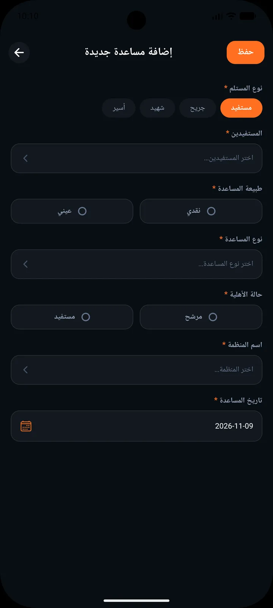
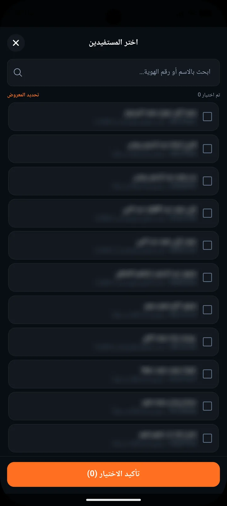
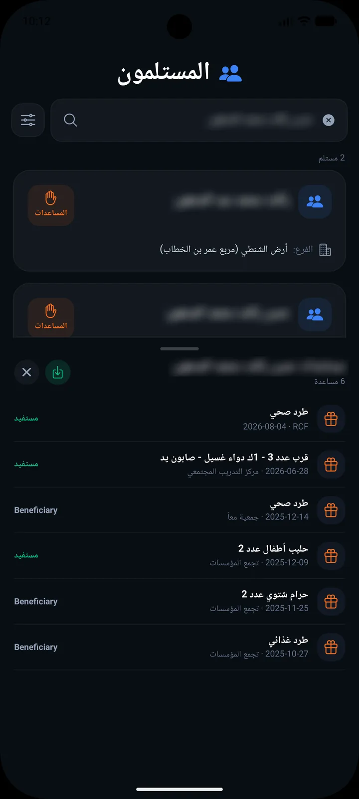
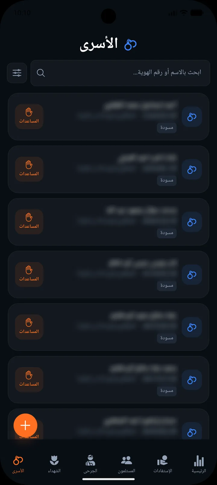

<div align="center">

# إدارة الاستفادات · Aid Management

**Arabic RTL mobile app for tracking beneficiaries and humanitarian aid distribution.**

Live dashboard · offline-first sync · record registries · fast bulk aid entry


</div>

---

## Screenshots

> Personal data (names, ID numbers) is blurred.

<table>
  <tr>
    <td align="center" width="33%">
      <br />
      <b>Dashboard</b><br />
      <sub>Live totals, sync progress and a 6-month aid chart</sub>
    </td>
    <td align="center" width="33%">
      <br />
      <b>Aid list</b><br />
      <sub>Search and filter aid records by type and status</sub>
    </td>
    <td align="center" width="33%">
      <br />
      <b>New aid</b><br />
      <sub>Guided entry form with required-field validation</sub>
    </td>
  </tr>
  <tr>
    <td align="center" width="33%">
      <br />
      <b>Bulk select</b><br />
      <sub>Pick many beneficiaries at once with search</sub>
    </td>
    <td align="center" width="33%">
      <br />
      <b>Recipient history</b><br />
      <sub>Per-person aid history in a bottom sheet, with export</sub>
    </td>
    <td align="center" width="33%">
      <br />
      <b>Registries</b><br />
      <sub>Prisoners, martyrs and wounded, each linked to their aid</sub>
    </td>
  </tr>
</table>

## Features

- **Dashboard** — beneficiary and aid totals, monthly count, pending-sync counter, records summary and a 6-month chart.
- **Offline-first** — data is cached in SQLite (`expo-sqlite`) and synced in the background with visible progress.
- **Aids** — list, search, filter (cash / in-kind, beneficiary / candidate), details, and bulk creation for many recipients at once.
- **Recipients & registries** — recipients, prisoners, martyrs and wounded, each with filters and per-person aid history.
- **Export** — share a person's aid history as a file.
- **Auth** — Frappe login with tokens kept in `expo-secure-store`.
- **RTL Arabic UI** — dark theme built with NativeWind.

## Tech stack

| Layer | Tools |
| --- | --- |
| App | Expo 54, React Native 0.81, Expo Router, TypeScript |
| UI | NativeWind (Tailwind), Reanimated, `@expo/vector-icons` |
| State & data | Zustand, TanStack Query, Axios |
| Storage | expo-sqlite (offline cache), expo-secure-store, AsyncStorage |
| Backend | Frappe (`aids.api.*` whitelisted methods) |

## Project structure

```
app/          Expo Router screens: (tabs)/ for main tabs, plus forms and detail screens
components/   Shared UI components
lib/          API client, offline DB, sync, filters, export helpers
store/        Zustand stores (auth, sync, app)
assets/       Icons and splash
docs/         README screenshots
```

## Getting started

```bash
npm install
npm start          # Expo dev server
npm run android    # run on Android
npm run ios        # run on iOS
```

Set the backend URL in `lib/config.ts` (`API_BASE_URL`).

## Scripts

| Command | What it does |
| --- | --- |
| `npm start` | Start the Expo dev server |
| `npm run android` / `npm run ios` | Build and run natively |
| `npm run lint` | ESLint + Prettier check |
| `npm run format` | Auto-fix lint and formatting |
